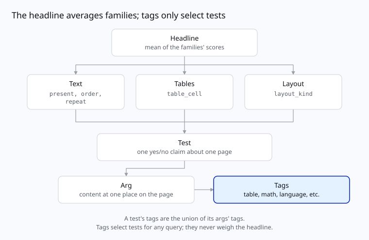
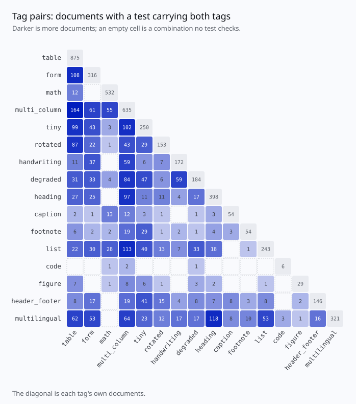
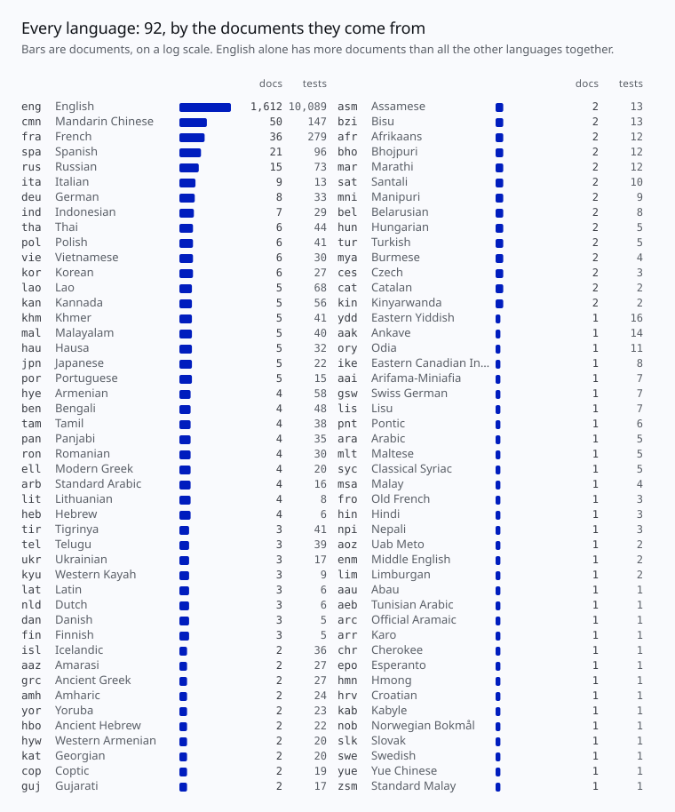
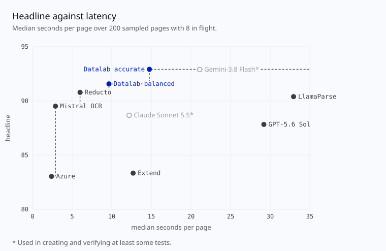
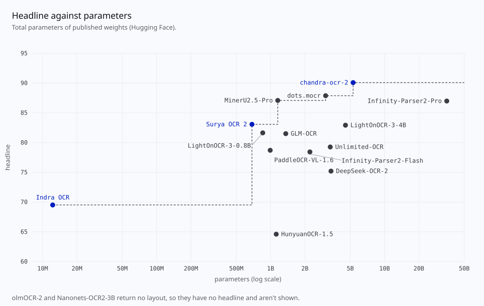
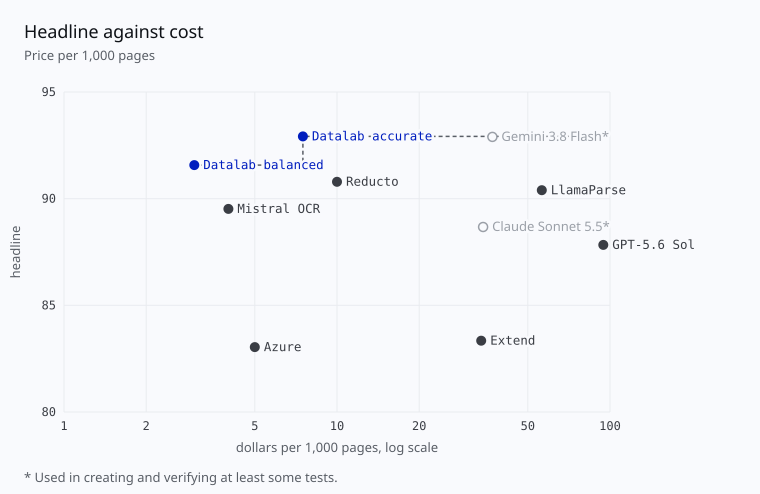
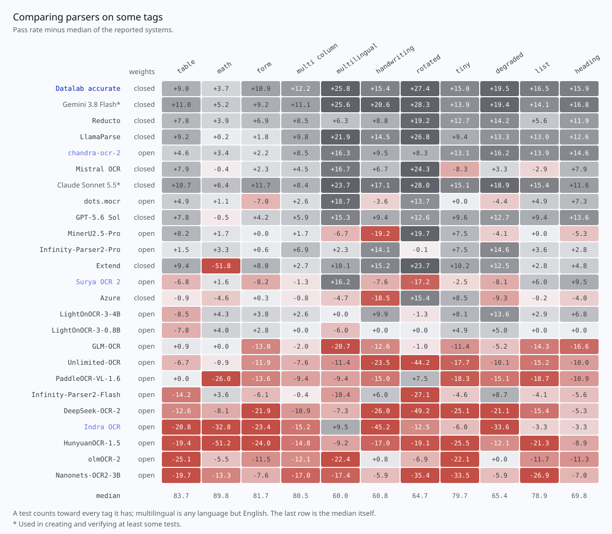

# Omni Parse Bench

Choosing a document parser usually starts with a leaderboard: one number per parser. But nobody parses an
average document, and the parser that wins on average can be the one that fails on yours. Omni Parse Bench
is built to answer the question you actually have: which parser is best on documents like mine? It is:

- clear: every test is a yes/no question about one page (is this content in the output, in this order, in a
  table cell under these headings, in a layout block of this kind?), every score is the share of tests
  passed, and every score comes with the number of tests and documents behind it, so a thin slice says it
  is thin;
- auditable: every test records how its answer was established, and the scorer is open code with no model
  judging the outputs; and
- explorable: every test is tagged by what its content is (a table cell, handwriting, a rotated page, Thai),
  so any slice of the benchmark gets its own score.

It has 16,288 tests on 2,937 pages from 2,343 documents over 22 suites, in
92 languages. Omni Parse Bench is developed by Datalab.

Read more in our [blog post](https://www.datalab.to/blog/omni-parse-bench). Also see the [GitHub](https://github.com/datalab-to/omni_parse_bench) for the scorer and the harness that
runs parsers on the benchmark.

## The design



The headline is the mean of three family scores: text, tables and layout. A family is a group of test
types:

| test type | checks | family | tests |
|---|---|---|---:|
| `present` | this text, number or equation appears | text | 7,275 |
| `order` | text A comes before text B | text | 1,189 |
| `repeat` | this line appears exactly N times | text | 35 |
| `table_cell` | this cell sits under these headings and beside these neighbors | tables | 5,386 |
| `layout_kind` | the block holding this line is a heading, text or table | layout | 2,403 |

A test checks one or more args, each of which is the content at one place on the page. Each arg is
tagged:

- structure: `table`, `math`, `form` and `multi_column`;
- rendering: `handwriting`, `tiny`, `rotated` and `degraded`;
- role: `heading`, `caption`, `footnote`, `list`, `code`, `figure` and `header_footer`;
- script: ISO 15924 codes (`Latn`, `Hani`, `Deva`, ...); and
- language: ISO 639-3 codes (`eng`, `fra`, `tha`, ...).

A test's tags are the union of its args' tags. Tags never decide whether a test passes or what the
headline is; they select tests, so any slice of the benchmark can be scored. A test with several tags
counts in each, so per-tag scores overlap and don't average to the headline.

Each tag was decided from the page alone: computed where it can be (a script from Unicode, a font
size, a rotation we made), from a source where one exists (publisher markup, form widgets),
else by two models shown the content boxed on the page, with a third settling their splits by fixed
rules; whatever they couldn't settle was decided by a person, who also checked a random sample of 30
tagged pieces of content and found no wrong tag.

## Data






## Results

| parser | weights | headline | text | tables | layout |
| --- | --- | ---: | ---: | ---: | ---: |
| **Datalab accurate** | closed | 92.9 | 91.2 | 92.0 | 95.6 |
| Gemini 3.8 Flash* | closed | 92.9 | 91.3 | 95.2 | 92.2 |
| **Datalab balanced** | closed | 91.6 | 90.0 | 89.2 | 95.5 |
| Reducto | closed | 90.8 | 85.4 | 91.2 | 95.8 |
| LlamaParse | closed | 90.4 | 88.2 | 92.6 | 90.4 |
| **chandra-ocr-2** | open | 90.1 | 87.4 | 87.4 | 95.4 |
| Mistral OCR | closed | 89.5 | 82.8 | 91.9 | 93.8 |
| Claude Sonnet 5.5* | closed | 88.7 | 93.1 | 95.4 | 77.5 |
| dots.mocr | open | 87.9 | 82.5 | 88.6 | 92.5 |
| GPT-5.6 Sol | closed | 87.8 | 85.4 | 91.6 | 86.5 |
| MinerU2.5-Pro | open | 87.1 | 77.4 | 92.1 | 91.7 |
| Infinity-Parser2-Pro | open | 87.0 | 83.3 | 84.1 | 93.5 |
| Extend | closed | 83.3 | 64.1 | 92.5 | 93.4 |
| **Surya OCR 2** | open | 83.1 | 80.6 | 74.3 | 94.3 |
| Azure | closed | 83.0 | 74.6 | 81.7 | 92.8 |
| LightOnOCR-3-4B | open | 82.9 | 83.9 | 70.8 | 94.0 |
| LightOnOCR-3-0.8B | open | 81.6 | 81.1 | 72.1 | 91.7 |
| GLM-OCR | open | 81.5 | 71.0 | 84.2 | 89.3 |
| Unlimited-OCR | open | 79.3 | 70.2 | 76.5 | 91.1 |
| PaddleOCR-VL-1.6 | open | 78.7 | 61.7 | 83.7 | 90.7 |
| Infinity-Parser2-Flash | open | 78.4 | 78.4 | 66.5 | 90.4 |
| DeepSeek-OCR-2 | open | 75.2 | 64.2 | 70.0 | 91.4 |
| **Indra OCR** | open | 69.5 | 60.3 | 58.1 | 90.1 |
| HunyuanOCR-1.5 | open | 64.6 | 50.5 | 61.9 | 81.4 |
| olmOCR-2 | open | none | 71.3 | 56.6 | unsupported |
| Nanonets-OCR2-3B | open | none | 68.2 | 62.6 | unsupported |
| Tesseract | open | none | 17.6 | 0.0 | unsupported |

\* Used in creating and verifying at least some tests.

Open-weight models are served on their own host (a GPU, or CPU only for Indra OCR) from omni-parse-bench's
server images, with the defaults each vendor recommends; each adapter's docstring lists where it differs.

The headline is the mean of three family scores: text (`present`, `order` and `repeat` tests), tables
(`table_cell`) and layout (`layout_kind`). Tesseract, olmOCR-2 and Nanonets-OCR2-3B return no layout, so
they have no headline.

Every verdict behind these numbers is in `results.parquet`: one row per parser and test, with the test's
page, document, suite, type, derivation and tags, its `result` (`pass`, `fail`, or `unsupported` when the
parser can't produce that output) and `why` it failed. Browse it as the `results` subset in the viewer
above, or query it; for instance, the share of handwriting tests each parser passes:

```sql
select system, round(100 * avg((result = 'pass')::int), 1) as score, count(*) as tests
from 'hf://datasets/datalab-to/omni_parse_bench/results.parquet'
where result in ('pass', 'fail') and list_contains(tags, 'handwriting')
group by system order by score desc;
```









## Layout

```
manifest.parquet        one row per page
pages/<page_id>.pdf     the page that gets sent: a one-page PDF, or a .png for an image page
gold/<page_id>.json     its tests: {"tests": [...]}
results.parquet         every parser's verdict on every test (Results above)
licenses/               the license, and the credit it requires, of each source
assets/                 the charts on this card
```

| column | |
|---|---|
| `page_id` | unique; the files carry it |
| `document` | the document the page comes from; scores count documents as well as tests |
| `suite` | which part of the benchmark the page came from |
| `doc_path` | `pages/<page_id>.pdf` (or `.png`), relative to the dataset root |
| `gt_path` | `gold/<page_id>.json`, relative to the dataset root |
| `outputs` | the output types its tests read (`html`, `blocks`): what to predict for the page |

A test says what structure of the output it checks (`test_type`), in which output (`output_type`),
on what content (`args`), with what else it needs (`settings`); how its answer was established
(`derivation`); and what its content is (`tags`):

```json
{
    "id": "p11_PMC12397559.1_t0_head_17_2",
    "test_type": "table_cell",
    "output_type": "html",
    "derivation": "publisher_markup",
    "tags": ["Latn", "eng", "multi_column", "table"],
    "args": {
        "cell": {"text": "32 (40.0)", "max_diffs": 0},
        "headings": [{"text": "No. (%)", "max_diffs": 0}]
    },
    "settings": {}
}
```

An arg is `{"text", "max_diffs"}`, `{"number"}` or `{"latex"}`, and its kind says how it is
compared: text within `max_diffs` edits, a number digit for digit, LaTeX by what it renders (or by its plain
text, when plain text writes it without loss).

## Install

```bash
uv pip install omni-parse-bench                 # the scorer: score(), no network, no API keys
uv pip install 'omni-parse-bench[harness]'      # + vendor adapters, to predict
uv pip install 'omni-parse-bench[benchmark]'    # + dataset access, to run the benchmark
```

This revision of the dataset needs omni-parse-bench 0.1.2 or newer. With 0.1.1, use the revision made for
it: `--dataset hf://datasets/datalab-to/omni_parse_bench@1c35a52`.

## Run the benchmark

With `[benchmark]` installed, run parsers on the dataset (5 pages here). It shows the plan and asks before
calling any vendor, since calls cost money; each vendor needs its API key in the environment. A run is
resumable: stop it, and run the same command again to carry on.

```bash
opb benchmark --out runs/ --limit 5 --providers datalab openai/gpt-5.6-sol
```

Each setting of a provider is its own run; here, two:

```bash
opb benchmark --out runs/ --limit 5 --providers datalab   --options '{"datalab": [{"mode": "balanced"}, {"mode": "accurate"}]}'
```

`--dataset` picks the dataset: a folder, or `hf://datasets/datalab-to/omni_parse_bench@<revision>` (this one, at `main`, by
default). Corrections land on `main` as new commits; pin a revision to reproduce a result. Each run's
`scores.jsonl` has one line per test, with what the test is beside its verdict, so a run can be compared by
tag, suite or test type: see [`docs/API.md`](https://github.com/datalab-to/omni_parse_bench/blob/main/docs/API.md#asking-a-question).

## Score

Use in your own code: one page with three tests, written inline so the gold file's shape is visible
(`gold.read("gold/<page_id>.json")` reads a file).

```python
from omni_parse_bench import gold, score, summarize

tests = gold.parse("example-p1", {"tests": [
    {
        "id": "t1",
        "test_type": "present",
        "output_type": "html",
        "derivation": "text_layer",
        "tags": ["Latn", "eng"],
        "args": {"content": {"text": "Quarterly revenue rose 12%", "max_diffs": 1}},
        "settings": {},
    },
    {
        "id": "t2",
        "test_type": "order",
        "output_type": "html",
        "derivation": "text_layer",
        "tags": ["Latn", "eng", "heading"],
        "args": {
            "before": {"text": "Summary", "max_diffs": 0},
            "after": {"text": "Outlook", "max_diffs": 0},
        },
        "settings": {},
    },
    {
        "id": "t3",
        "test_type": "table_cell",
        "output_type": "html",
        "derivation": "publisher_markup",
        "tags": ["table"],
        "args": {
            "cell": {"text": "4.2", "max_diffs": 0},
            "top_heading": {"text": "Q3", "max_diffs": 0},
        },
        "settings": {},
    },
]})

outputs = {
    "html": (
        "<h2>Summary</h2>"
        "<p>Quarterly revenue rose 12% on the year.</p>"
        "<table>"
        "<tr><th>Q2</th><th>Q3</th></tr>"
        "<tr><td>3.9</td><td>4.1</td></tr>"
        "</table>"
        "<h2>Outlook</h2>"
    ),
}
verdicts = score(outputs, tests)
```

```python
>>> verdicts
[Verdict(id='t1', result='pass', why=''),
 Verdict(id='t2', result='pass', why=''),
 Verdict(id='t3', result='fail', why="no cell matching '4.2' in any table")]

>>> s = summarize(verdicts, tests)["html"]
>>> s["score"], s["per_test_type"], s["per_tag"]["table"]
(0.6666666666666666, {'present': 1.0, 'order': 1.0, 'table_cell': 0.0}, {'score': 0.0, 'tests': 1, 'pages': 1})
```

A verdict is `pass`, `fail`, `unsupported` (the parser can't produce that output) or `error` (grading
raised: a bug in the scorer, not the parser's fault), with `why` saying what went wrong. `unsupported`
and `error` verdicts are left out of every score.

From the command line, with the outputs in a JSON file:

```bash
opb score --pred outputs.json --gold gold/<page_id>.json
```

## Predict

With `[harness]` installed, predict with our provider adapters:

```python
from omni_parse_bench import harness

record = harness.predict("datalab", "pages/<page_id>.pdf", {"html", "blocks"}, mode="balanced")
record["outputs"]       # {"html": "...", "blocks": [...]}
record["errors"]        # {output: why} for anything that failed
record["calls"]         # what was sent, cost, wall time

score(record["outputs"], gold.read("gold/<page_id>.json"))
```

From the command line:

```bash
opb predict --provider openai/gpt-5.6-sol --page pages/<page_id>.pdf --wants html
opb providers        # every provider, and its options
```

## How the tests were built

What a test is made of, where each part of it comes from (its derivation says which source gave its
answer), and how tags are decided: [`docs/building-tests.md`](https://github.com/datalab-to/omni_parse_bench/blob/main/docs/building-tests.md)
and [`docs/tagging.md`](https://github.com/datalab-to/omni_parse_bench/blob/main/docs/tagging.md) in the repository.

## License

Each source's license, and the credit it requires, is a file in `licenses/`; each PubMed Central
article's credit is a row of `licenses/pmc_articles.csv`.

The pages are public documents, pages of public datasets, and copies of them we filled in or rebuilt. A dataset's license
covers what its makers could license; the documents it collected keep their owners' rights, and are
credited here to their source. Pages whose own license forbids redistribution or commercial use (a
PubMed Central article under CC BY-NC, for one) are left out. Two sources ask for non-commercial use
and are kept, as fair use, with our reasons in their files: the Ohio Department of Transportation
drawings (`ohio-dot-LICENSE.txt`), and the three Copiste d'un jour pages, whose writers consented to
non-commercial use (`htr-united-LICENSE.txt`).

The tests, and what we added to pages (form fills, handwriting), are Datalab's, under CC BY 4.0
(https://creativecommons.org/licenses/by/4.0/legalcode). Tests converted from olmOCR-bench and
fr-bench-pdf2md keep their licenses (ODC-BY 1.0 and MIT), and the tests on the three Copiste d'un
jour pages, which quote Wikipedia, are CC BY-SA 4.0 (`htr-united-LICENSE.txt`).

If you hold rights in a page and want it removed, open an issue at
https://github.com/datalab-to/omni_parse_bench/issues.

The scorer and harness are Apache 2.0.

| suites | pages | license file |
|---|---:|---|
| olmo_arxiv_math, olmo_long_tiny_text, olmo_multi_column, olmo_old_scans, olmo_old_scans_math, olmo_table_tests | 974 | `olmocr-bench-LICENSE.txt` |
| tables_derived | 528 | `pmc-LICENSE.txt`, with each article's credit in `pmc_articles.csv` |
| docparsing_images | 71 | `docparsingbench-LICENSE.txt` |
| parsebench_docs | 81 | `parsebench-LICENSE.txt` |
| realdoc_pdfs, realdoc_pages | 210 | `realdoc-bench-LICENSE.txt` |
| multiling_finepdfs | 158 | `finepdfs-LICENSE.txt` |
| rotation_skew | 142 | the file of the page it is a rotated copy of: `pmc-LICENSE.txt`, `parsebench-LICENSE.txt` or `realdoc-bench-LICENSE.txt` |
| forms_filled | 34 | `us-federal-forms-LICENSE.txt` and `cerfa-LICENSE.txt` |
| forms_federal | 31 | `us-federal-forms-LICENSE.txt` |
| multilingual | 42 | `cerfa-LICENSE.txt` and `nta-LICENSE.txt` |
| frbench_handwriting | 29 | `fr-bench-pdf2md-LICENSE.txt` and `cerfa-LICENSE.txt` |
| forms_documentcloud | 17 | `documentcloud-LICENSE.txt` |
| large_format, tiny_plans | 87 | `ohio-dot-LICENSE.txt` |
| handwriting_samples | 39 | `loc-catt-papers-LICENSE.txt`, `nls-marjory-fleming-LICENSE.txt` and `htr-united-LICENSE.txt` |
| synth_copies | 494 | the file of the page it is rebuilt from: `realdoc-bench-LICENSE.txt`, `parsebench-LICENSE.txt`, `docparsingbench-LICENSE.txt`, `olmocr-bench-LICENSE.txt` or `finepdfs-LICENSE.txt` |

## Citation

```bibtex
@misc{omniparsebench2026,
  title        = {Omni Parse Bench: A Document-Parsing Benchmark},
  author       = {{Datalab}},
  year         = {2026},
  howpublished = {\url{https://github.com/datalab-to/omni_parse_bench}},
}
```

Please also cite the upstream datasets whose pages or tests this benchmark uses:

- olmOCR-bench (Ai2): Poznanski J. et al. (2025). olmOCR: Unlocking Trillions of Tokens in PDFs with Vision Language Models;
- ParseBench (LlamaIndex): Zhang B. et al. (2026). ParseBench: A Document Parsing Benchmark for AI Agents;
- DocParsingBench (SoMark): SoMark (2026). DocParsingBench. https://huggingface.co/datasets/SoMarkAI/DocParsingBench;
- fr-bench-pdf2md (pulsia): pulsia (2026). Benchmarking Vision-Language Models for French PDF-to-Markdown Conversion;
- RealDoc-Bench and RealDoc-Bench-Layout (Extend AI): https://huggingface.co/datasets/Extend-AI/RealDoc-Bench; and
- FinePDFs (Hugging Face): https://huggingface.co/datasets/HuggingFaceFW/finepdfs.
